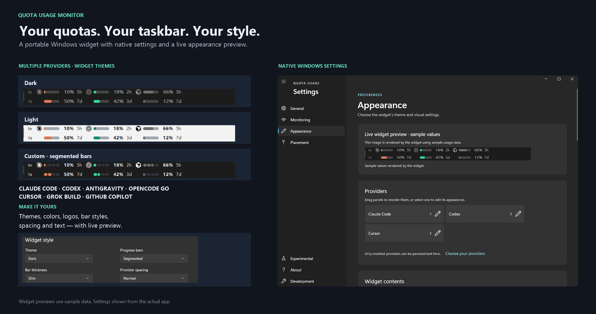

# Quota Usage Monitor

Quota Usage Monitor is a lightweight, portable, easy-to-use, customizable, open-source Windows taskbar widget for monitoring usage limits and reset times across **Claude Code, Codex, Antigravity, OpenCode Go, Cursor, Grok Build, GitHub Copilot, and other providers**. Configure it through a **native Windows settings GUI**, with a live appearance preview and separate logo and color controls for each provider.



## Features

- Monitor seven providers from the Windows taskbar and notification area.
- View available quota windows and reset times; the windows depend on the provider.
- Choose providers, polling options, language, widget placement, and Windows startup behavior.
- Select System, Dark, or Light appearance and customize each provider's logo visibility and color.
- Preview appearance changes before applying them. Save or discard settings manually; there is no autosave.
- Retrieve usage directly from provider services, without a monitor backend or telemetry.

## Requirements

- Windows 10 or Windows 11.
- Existing sign-in credentials for the providers you enable; see [Provider setup](#provider-setup).
- For native settings: **Windows App Runtime 1.8, x64**, at the servicing level required by the pinned Windows App SDK **1.8.260921001**. Use [Microsoft's Windows App SDK downloads](https://learn.microsoft.com/windows/apps/windows-app-sdk/downloads) to obtain the x64 installer. The app does not bundle or install this shared runtime. The settings companion does not require a .NET runtime.

## Installation

### Portable download

Download and run `quota-usage.exe` from the [latest release](https://github.com/rozsazoltan/quota-usage-monitor/releases/latest). No installer is needed. Settings are included; the [Windows App Runtime](#requirements) must be installed separately.

### Scoop and marcosnils/bin

With Scoop installed, install [`marcosnils/bin`](https://github.com/marcosnils/bin) from its extras bucket, then use `bin` to install Quota Usage:

```powershell
scoop bucket add extras
scoop install extras/bin
bin install github.com/rozsazoltan/quota-usage-monitor
```

## Usage

Start `quota-usage.exe`. Right-click the widget or notification-area icon to open its menu, then choose **Settings**. Left-click the tray icon to hide or show the widget.

In **Monitoring**, choose the providers to display. Codex is enabled by default; newly added providers are off. Normally, at least one and at most three providers must be enabled. **Experimental** offers an override for the upper limit; enabling more providers can make the widget too wide for the taskbar.

In **Appearance**, use a provider's pencil button to adjust its logo visibility and color independently. Use the live preview, then the fixed save/discard controls to apply or abandon changes. Enable **Start with Windows** in Settings for automatic startup.

Grok Build and GitHub Copilot show their quota pool on the long-window row, with no short-window value. OpenCode Go can use a weekly or monthly long window. Not every provider has a five-hour window.

Print the version from the executable's folder:

```powershell
.\quota-usage.exe --version
# Also supported: .\quota-usage.exe -v
```

### Update and remove

The app checks for updates once per normal startup. To check manually, open **About** and choose **Check for updates**. When an update is available, an **Update** page appears above About with a blue dot; choose **Install update** there or in About.

Choose **Uninstall Quota Usage** in About to remove the app. Preferences are kept unless you choose to remove them in the second confirmation. A portable copy removes its executable and matching startup entries, not its containing folder; a managed installation also removes its shortcuts and uninstall registration.

For an installation managed by `bin`, use `bin remove <binary>`, replacing `<binary>` with the installed binary name, to remove its package entry too.

The app's uninstaller removes its private settings-companion cache, but never the shared Windows App Runtime. External package-manager removal may leave the cache behind.

## Provider setup

| Provider | Setup |
| --- | --- |
| Claude Code | Run `claude`, then `/login`. Windows CLI credentials are detected; WSL credentials can be used as a fallback. Claude Desktop sign-in is **not** supported. |
| Codex | Install the Codex CLI and sign in with `codex`. |
| Antigravity | Sign in to Antigravity. The monitor reads its OAuth token from Windows Credential Manager under `gemini:antigravity`. |
| OpenCode Go | Configure the workspace ID and console session cookie as described below. |
| Cursor | Sign in to Cursor; its local session is detected automatically. `CURSOR_SESSION_TOKEN` can override it. |
| Grok Build | Sign in with `grok login`. The monitor reads the CLI session from `%USERPROFILE%\.grok\auth.json`; `GROK_HOME` selects a different home directory. Only xAI sign-in entries are used, not stored API keys or other identity-provider sessions. |
| GitHub Copilot | Sign in using the Copilot CLI or `gh auth login`. Token candidates are checked in this order: `COPILOT_GITHUB_TOKEN`, `GH_TOKEN`, `GITHUB_TOKEN`, Copilot CLI credentials, then GitHub CLI credentials from Windows Credential Manager. |

Enable each configured provider in **Monitoring**.

### OpenCode Go credentials

Set `OPENCODE_GO_WORKSPACE_ID` and `OPENCODE_GO_AUTH_COOKIE`, or create `%APPDATA%\opencode-go\config.json` with these keys:

```json
{
  "workspaceId": "your-workspace-id",
  "authCookie": "__Host-console_session=your-session-cookie-value"
}
```

The workspace ID appears in `https://opencode.ai/console/<workspaceId>/go`. Obtain the `__Host-console_session` cookie from your authenticated `opencode.ai` browser session. A full Cookie header containing that cookie or the legacy `auth` cookie is also accepted; bare legacy `auth` values remain supported. `OPENCODE_GO_CONFIG_FILE` adds a custom configuration-file path to the search list.

Treat this file as a credential: it stores the cookie in plain text. Do not commit or share it.

## Data and privacy

The monitor reads local credentials for enabled providers and sends authenticated HTTPS usage requests directly to their services. OAuth or session credentials are sent to the relevant provider; there is no Quota Usage backend, analytics, telemetry, or project-file upload. Update checks and downloads contact GitHub. Requests may use an environment-configured proxy, so use only proxies and certificate authorities you trust.

At startup, enabled providers whose credentials are unavailable are switched off and the updated selection is saved before polling begins. Sign in and enable them again in Settings when ready. Debug-only Development overrides remain temporary and do not change this saved selection.

- Claude Code credentials come from `~/.claude/.credentials.json`, `CLAUDE_CONFIG_DIR` on Windows, or a WSL fallback. Codex credentials come from `$CODEX_HOME/auth.json` or `~/.codex/auth.json`.
- Expired Claude Code, Codex, or Grok sessions may trigger a background refresh through the owning CLI. The monitor does not directly rewrite their credential files. For expired Antigravity credentials, reopen Antigravity and sign in.
- Local preferences and state include provider selection, appearance, language, polling, placement, visibility, quota-row options, alert thresholds, notification deduplication keys, and the last update-check time.
- Extracted settings payloads are SHA-256 verified on reuse and held read-only while the companion runs. Extraction rejects unexpected files and reparse points.

## Troubleshooting

- **Settings will not open:** install or repair the x64 Windows App Runtime 1.8 at the required servicing level. The app reports this prerequisite but does not silently install it.
- **Settings payload verification fails:** close all Quota Usage instances, delete only the affected version folder under `%LOCALAPPDATA%\QuotaUsage\SettingsPayloads`, then restart. Leave preferences and the shared runtime intact. Junction/reparse-point cache directories are unsupported.
- **Missing quota data or rejected credentials:** sign in again with the affected provider, then choose **Refresh** from the app menu. Claude Desktop authentication cannot replace Claude Code CLI sign-in.
- **The app does not start or the widget is missing:** run this command from the executable's folder:

  ```powershell
  .\quota-usage.exe --diagnose
  ```

  The diagnostic log is `%TEMP%\quota-usage.log`. Review and redact sensitive information before sharing it.

## Build from source

Install Rust and the native build prerequisites listed in [settings-ui/BUILDING.md](settings-ui/BUILDING.md), then run these commands on Windows from the repository root:

```powershell
cargo run
cargo test
```

Debug builds and tests automatically restore, build, publish, and embed the native settings companion. For Rust-only work, explicitly set `QUOTA_SETTINGS_SKIP_NATIVE_BUILD=1`; settings then use the `settings-ui/bin/portable` fallback. The legacy `CODEX_SETTINGS_SKIP_NATIVE_BUILD` variable remains supported as a fallback.

### Portable release

Follow the prerequisites in [settings-ui/BUILDING.md](settings-ui/BUILDING.md), then run:

```powershell
./scripts/build-release.ps1
```

Builds the native settings companion and `target/release/quota-usage.exe`. Use this script rather than plain `cargo build --release`; the shared Windows App Runtime is not bundled.

### Release version policy

Releases use `YYYY.M.patch` CalVer, such as `2026.10.0`. **Prepare release version** maintains the version automatically; do not edit it manually.

To publish, run **Release → Run workflow** on the default branch after version preparation completes. If preparation is stale, run **Prepare release version** first. Retry failed releases through their original workflow run; do not move or delete published tags.

## Contributing and community

Fork the repository, make a focused change, and open a pull request. Run the relevant Rust tests; for native settings changes, follow the build and smoke-test instructions in [settings-ui/BUILDING.md](settings-ui/BUILDING.md). Report reproducible problems through [GitHub Issues](https://github.com/rozsazoltan/quota-usage-monitor/issues), without credentials or unredacted diagnostic logs.

## Acknowledgments

Developed by [Zoltán Rózsa](https://datarose.net).

Quota Usage is an independently maintained derivative of [upstream-ray/codex-usage-monitor](https://github.com/upstream-ray/codex-usage-monitor), preserving its Codex provider and upstream lineage. Thanks to [CodeZeno/Claude-Code-Usage-Monitor](https://github.com/CodeZeno/Claude-Code-Usage-Monitor) for the original inspiration and README structure. Quota Usage has its own native settings interface.

Provider icon sources include [Lobe Icons](https://github.com/lobehub/lobe-icons). Required upstream MIT copyright and license texts are preserved in [THIRD-PARTY-NOTICES.txt](THIRD-PARTY-NOTICES.txt). Provider names and logos belong to their respective owners; this project is not affiliated with or endorsed by them or the upstream maintainers.

## License

Licensed under the [GNU Affero General Public License v3 or later](LICENSE).
